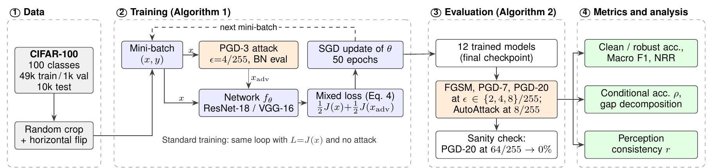
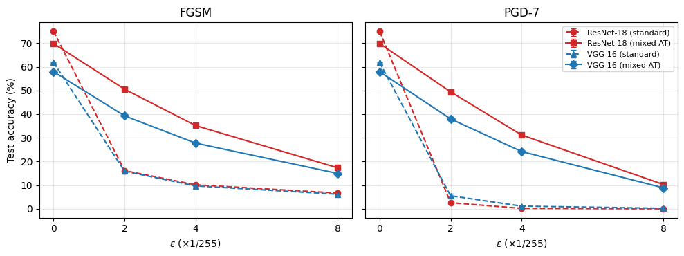
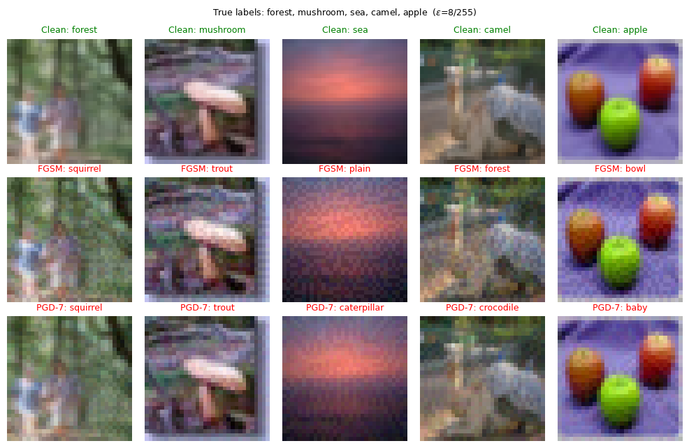

<div align="center">

# Clean Accuracy Explains Most of the Robustness Gap

### A Controlled Comparison of ResNet-18 and VGG-16 under Adversarial Training on CIFAR-100

**Marlen Oryntay**¹ · **Anwar Ghani**²

¹ National Physics and Mathematics School, Almaty, Kazakhstan &nbsp;·&nbsp; ² School of Computing and Artificial Intelligence, Nazarbayev University, Astana, Kazakhstan

[](paper/Oryntay_Ghani_2026_Clean_Accuracy_Explains_Robustness_Gap.pdf)
[](https://colab.research.google.com/github/XteteX/Adversarial-Robustness-CIFAR100/blob/main/notebooks/adversarial_robustness_cifar100.ipynb)
[](https://kaggle.com/kernels/welcome?src=https://github.com/XteteX/Adversarial-Robustness-CIFAR100/blob/main/notebooks/adversarial_robustness_cifar100.ipynb)

[](LICENSE)

</div>

---

## TL;DR

Residual networks are often reported to be more robust than plain sequential networks after adversarial training. But a model that classifies more clean images correctly also has more images that *can* survive an attack. We train **ResNet-18** and **VGG-16** on **CIFAR-100** with an identical recipe (3 seeds, 12 models) and split robust accuracy into *clean accuracy × the fraction of correct predictions that survive the attack*.

**About 70 % of ResNet-18's robustness advantage at ε ≤ 4/255, and all of it at ε = 8/255, comes from its higher clean accuracy, not from being harder to attack.**

<p align="center">
  
  <br><em>Overview of the study (Fig. 1 of the paper).</em>
</p>

---

## Key findings

1. **No defence, no robustness.** Without adversarial training, PGD-20 at ε = 4/255 drives both networks to ≤ 0.5 % accuracy.
2. **Mixed-loss adversarial training works at the budget it was trained on.** At ε = 4/255, PGD-20 accuracy rises to **28.17 %** (ResNet-18) and **21.84 %** (VGG-16), at a clean-accuracy cost of 5.15 and 3.94 points. It transfers poorly to ε = 8/255 (AutoAttack: 5.77 % and 4.13 %).
3. **The architecture gap is mostly a clean-accuracy gap.** ResNet-18 is ahead in absolute robust accuracy at every budget, but about 70 % of the gap at ε ≤ 4/255 and all of it at ε = 8/255 is explained by its higher clean accuracy.
4. **"Best checkpoint" selection can double the measured trade-off.** Selecting checkpoints on a small (1,000-image) robust validation set makes VGG-16's clean-accuracy cost look like 8.3 points instead of 3.9.
5. **The "failure cases are better learned" pattern** reported for PGD-AT by Wang & Liu (ICCV 2025) **does not appear** under this weaker objective, although adversarial training moves both networks towards it.

---

## Results

All numbers are the **mean ± std over 3 seeds**, final (last-epoch) checkpoint, CIFAR-100 test set, ℓ∞ threat model.

**Table I: accuracy (%) at ε = 8/255**

| Model | Clean | Macro F1 | FGSM | PGD-7 | PGD-20 | AutoAttack |
|---|---:|---:|---:|---:|---:|---:|
| ResNet-18 (standard) | 74.96<sub>±0.03</sub> | 0.750 | 6.68<sub>±0.47</sub> | 0.01<sub>±0.01</sub> | 0.00<sub>±0.00</sub> | 0.00<sub>±0.00</sub> |
| ResNet-18 (mixed AT) | 69.81<sub>±0.04</sub> | 0.697 | **17.37**<sub>±0.12</sub> | **10.27**<sub>±0.30</sub> | **7.10**<sub>±0.16</sub> | **5.77**<sub>±0.31</sub> |
| VGG-16 (standard) | 61.84<sub>±0.15</sub> | 0.622 | 6.19<sub>±0.43</sub> | 0.22<sub>±0.09</sub> | 0.07<sub>±0.06</sub> | 0.00<sub>±0.00</sub> |
| VGG-16 (mixed AT) | 57.90<sub>±0.64</sub> | 0.577 | 14.99<sub>±0.27</sub> | 8.86<sub>±0.14</sub> | 6.03<sub>±0.16</sub> | 4.13<sub>±0.12</sub> |

**Table II: PGD-20 accuracy and conditional robust accuracy ρ by budget (adversarially trained models)**

| Model | ε | PGD-20 (%) | NRR | ρ (%) |
|---|---|---:|---:|---:|
| ResNet-18 (AT) | 2/255 | 48.29<sub>±0.33</sub> | 57.1 | 69.2<sub>±0.5</sub> |
| | 4/255 | 28.17<sub>±0.37</sub> | 40.1 | 40.3<sub>±0.5</sub> |
| | 8/255 | 7.10<sub>±0.16</sub> | 12.9 | 10.2<sub>±0.2</sub> |
| VGG-16 (AT) | 2/255 | 37.05<sub>±0.63</sub> | 45.2 | 63.9<sub>±0.4</sub> |
| | 4/255 | 21.84<sub>±0.19</sub> | 31.7 | 37.7<sub>±0.1</sub> |
| | 8/255 | 6.03<sub>±0.16</sub> | 10.9 | 10.4<sub>±0.4</sub> |

**Table III: where the ResNet-18 vs VGG-16 gap comes from (PGD-20, percentage points)**

Robust accuracy factorises as `A_rob = A_clean · ρ`, where **ρ = P(correct under attack | correct on clean input)**. The gap between the two networks then splits exactly into a clean-accuracy part and a conditional-robustness part:

```
ΔA_rob = ΔA_clean · ρ_VGG  +  A_clean,ResNet · Δρ
```

| ε | Gap | Due to clean accuracy | Due to conditional robustness |
|---|---:|---:|---:|
| 2/255 | 11.24 | 7.62 (**68 %**) | 3.62 (32 %) |
| 4/255 | 6.33 | 4.49 (**71 %**) | 1.84 (29 %) |
| 8/255 | 1.07 | 1.24 (**116 %**) | −0.17 |

Full tables for both checkpoints, including NRR and the logit-MSE ratio, are in [`results/`](results/).

<p align="center">
  <br>
  <em>Test accuracy vs. ε under FGSM (left) and PGD-7 (right). Dashed: standard training; solid: mixed-loss adversarial training.</em>
</p>

<p align="center">
  <br>
  <em>Five test images classified correctly by the standard ResNet-18 (top) and misclassified after FGSM (middle) and PGD-7 (bottom) at ε = 8/255.</em>
</p>

### Is the evaluation trustworthy?

Weak or broken attacks can make a model look robust (gradient masking). We follow standard sanity checks:

* attacks are ordered as expected: FGSM > PGD-7 > PGD-20 > AutoAttack;
* PGD-20 with a huge budget (ε = 64/255) drives **every** model to 0 %;
* inside AutoAttack, the black-box Square attack finds no additional adversarial examples beyond the gradient-based APGD.

---

## Method

| Component | Setting |
|---|---|
| **Data** | CIFAR-100: 49k train / 1k validation / 10k test, random crop (padding 4) + horizontal flip. Pixels stay in [0, 1]; normalisation is the first layer of the model, so ε is in pixel units |
| **Networks** | ResNet-18 (11.22M parameters, 3×3 stem, no max-pool) and VGG-16-BN (15.30M parameters, global average pooling, 2×512 classifier) |
| **Training** | SGD (momentum 0.9, weight decay 5e-4), lr 0.1 ÷10 at epochs 25 and 37, batch 128, 50 epochs, 3 seeds |
| **Adversarial training** | L = ½·CE(x) + ½·CE(x_adv), with x_adv from PGD-3 (ε = 4/255, α = 1/255) crafted with BatchNorm in inference mode |
| **Attacks** | FGSM; PGD-7 (α = ε/4); PGD-20 (α = 2/255), all with random start; AutoAttack (standard: APGD-CE, APGD-T, FAB-T, Square) at ε = 8/255 on 1,000 test images |
| **Metrics** | Clean / robust accuracy, Macro F1, Natural-Robustness Ratio (NRR), conditional robust accuracy ρ, perception consistency (logit MSE, failed vs defended samples) |

The attacks (FGSM, PGD) are implemented from scratch in the notebook; AutoAttack uses the [official implementation](https://github.com/fra31/auto-attack).

---

## Reproduce

Everything lives in one notebook: [`notebooks/adversarial_robustness_cifar100.ipynb`](notebooks/adversarial_robustness_cifar100.ipynb). It includes the outputs of the final run (training logs, evaluation, tables and figures).

1. Open it in **Kaggle** or **Colab** using the badges above and switch on a GPU (the experiments used an NVIDIA Tesla T4).
2. Set `CFG['seeds']` in section 1, for example `[0]`. One seed (4 models) takes about 5 GPU-hours of training on a T4, so the notebook trains one seed per session and **resumes automatically** from the last saved epoch after a disconnect.
3. Run all cells. Finished runs are skipped. Results are written to JSON, and the tables and figures are generated from the JSON files, with no hard-coded numbers.

To combine seeds trained in different Kaggle sessions, add the earlier output folders (`robust_v2/`) as notebook inputs; the first cell merges them.

Model checkpoints are not included in this repository because of their size (12 models).

---

## Repository structure

```
Adversarial-Robustness-CIFAR100/
├── paper/
│   └── Oryntay_Ghani_2026_Clean_Accuracy_Explains_Robustness_Gap.pdf
├── notebooks/
│   └── adversarial_robustness_cifar100.ipynb   # training, attacks, evaluation, tables, figures
├── results/                                     # all reported numbers as CSV (mean, std over seeds)
├── figures/                                     # figures used in this README
├── requirements.txt
├── CITATION.cff
└── LICENSE
```

---

## Limitations

1. The adversarial-training objective is weaker than standard PGD-10 training at ε = 8/255, which explains the low robustness at 8/255. Conclusions at that budget should not be extrapolated to standard PGD-AT.
2. 50 training epochs: clean accuracy is below the best reported values for these architectures, especially for VGG-16.
3. AutoAttack runs on 1,000 test images (standard error ≈ 0.7 points at the measured accuracies).
4. One dataset and two architectures, which differ in more than skip connections (depth, parameter count, classifier head).
5. Three seeds: differences below one point should be read with caution.

---

## Citation

```bibtex
@misc{oryntay2026cleanaccuracy,
  title        = {Clean Accuracy Explains Most of the Robustness Gap: A Controlled Comparison
                  of {ResNet-18} and {VGG-16} under Adversarial Training on {CIFAR-100}},
  author       = {Oryntay, Marlen and Ghani, Anwar},
  year         = {2026},
  note         = {Preprint},
  howpublished = {\url{https://github.com/XteteX/Adversarial-Robustness-CIFAR100}}
}
```

## Acknowledgements

The first author thanks Professor Anwar Ghani (Nazarbayev University) for his mentorship and guidance throughout this research. Experiments ran on free GPU time from Kaggle and Google Colab.

## License

Code: [MIT](LICENSE). The paper PDF is © its authors.

<details>
<summary>Project history</summary>

* **July 2026:** a custom VGG-style CNN on CIFAR-10, attacked with FGSM and PGD and defended with FGSM-based adversarial training.
* **September 2026:** ResNet-18 vs VGG-16 on CIFAR-100 (Adam, 15 epochs, one seed, `torchattacks`).
* **October 2026 (this version):** the controlled multi-seed study described above. The notebook's header lists what changed. The most important change is a bug fix: input normalisation used to happen in the data loader, so the attack budget ε was applied in normalised units. Normalisation is now the first layer of the model, so ε = 8/255 really means 8/255 in pixel space.

</details>
